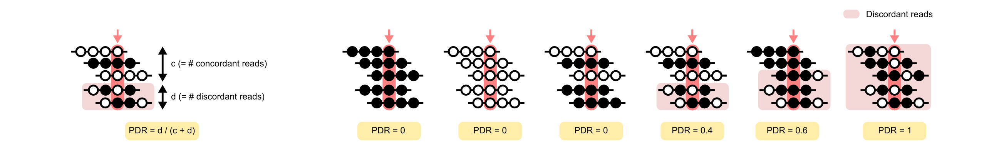
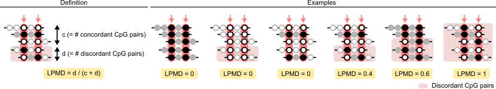
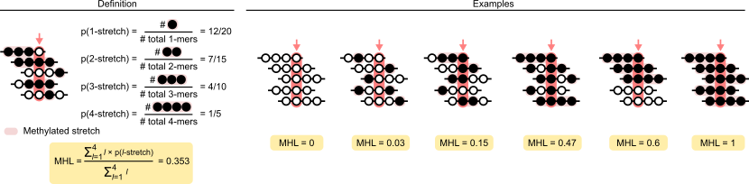
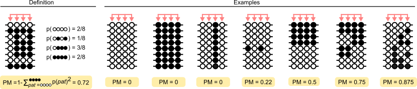
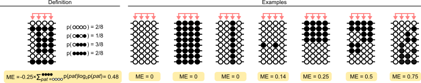

# Metheor ☄


[](https://anaconda.org/dohlee/metheor)
[](https://anaconda.org/dohlee/metheor)


Compute DNA methylation heterogeneity levels from Bismark-aligned bisulfite sequencing data.

## Motivation

Per-CpG methylation level is not the only information we can extract from bisulfite sequencing data.
We miss too much valuable clues about epigenetic ***stability*** and ***diversity*** by averaging out the signals!
We here provide an ultrafast, Rust-based bioinformatics tool for the computation of various intra-/inter-cellular methylation heterogeneity measures.

## Installation
Install with `conda`.
```
conda install -c dohlee metheor
```

Sort input alignments by reference coordinate before analysis (`samtools sort`).
PDR, MHL, FDRP and qFDRP validate this order. See [input requirements](docs/input-format.md)
for filtering, depth thresholds and output coordinates.

## Usage

### Overlapping paired-end reads

By default, each alignment is counted independently, including overlapping mates.
To avoid counting overlapping paired-end observations twice, add `--ignore-overlaps`
to any of the seven heterogeneity commands:

```
metheor pm --input sample.sorted.bam --output sample.pm.tsv --ignore-overlaps
```

This option requires coordinate-sorted input. It matches primary mates using their
read name, read group (`RG`, when present), opposite read-end flags, and reciprocal
alignment/mate coordinates. Reads without names (`QNAME=*`), missing mates, and
nonoverlapping observations are kept;
secondary and supplementary alignments retain their existing treatment.

For a duplicated observation, the first eligible alignment in coordinate order is
retained; input order breaks ties. Eligibility includes the command's mapping-quality,
CpG-count, and target-CpG filters. This selection is independent of Read 1/Read 2 priority or base quality.

The observation being deduplicated depends on the measure:

- PDR, MHL, FDRP, and qFDRP: each CpG's contribution from a fragment is counted once.
- LPMD: each CpG pair's contribution from a fragment is counted once.
- PM and ME: each exact CpG quartet's contribution from a fragment is counted once.

Full read patterns are preserved for computing read concordance, methylated
stretches, and unique quartets in partially overlapping mates. Mates are not merged,
and patterns spanning a gap between them are not inferred. Corrected observations
can reduce effective depth and cause loci to fall below `--min-depth`. Omit
`--ignore-overlaps` to reproduce the original alignment-wise counting.

### Native 5mC calls (MM/ML)

The seven measures accept native methylation calls when an alignment has MM/ML
tags and no Bismark XM tag. Existing XM tags take precedence. No bisulfite
conversion or additional tagging step is needed:

```
metheor pm --input native.sorted.bam --output native.pm.tsv
```

Metheor selects 5mC (`m`, or ChEBI `27551`) and calls it methylated when ML is
at least 128 (probability at least 0.5). Other modification types are not 5mC.
Explicit calls without ML remain unknown. The MM `?` mode leaves skipped bases
unknown; the default and `.` modes treat them as unmodified. Agreeing duplex
calls count once, and conflicting calls at the same CpG are excluded.

CpG context comes from adjacent reference-aligned bases of the read sequence;
unaligned bases and contexts spanning a deletion are excluded. Reverse
alignments, indels, multi-modification groups, and legacy Mm/Ml names are
supported. Invalid coordinates, ML lengths, and stale MN lengths are rejected.

FDRP and qFDRP retain long reads and compare their shared CpGs without a fixed
read-length limit. Per-CpG reservoir sampling still uses `--max-depth`; sampled
loci share read profiles instead of copying an entire read at every CpG.

### Supported methylation heterogeneity measures

`Metheor` supports seven methylation heterogeneity measures in total.

**Proportion of discordant reads (PDR)**



PDR is defined as a fraction of reads carrying CpGs in discordant methylation states (i.e. containing both methylated and unmethylated CpGs in a single read) with respect to all reads mapped to a CpG.
```
metheor pdr --input <input.bam> --output <output.tsv>
    --min-depth <min_depth> --min-cpgs <min_cpgs>
    --min-qual <min_qual> --cpg-set <cpg_set.bed>
```

*Options*

- `-i, --input`: Path to input BAM file.
- `-o, --output`: Path to output table file summarizing the result of PDR calculation.
- `-d, --min-depth`: Minimum depth of CpG stretches to consider. [default: 10]
- `-p, --min-cpgs`: Minimum number of consecutive CpGs in a CpG stretch to consider. [default: 10]
- `-q, --min-qual`: Minimum quality for a read to be considered [default: 10]
- `-c, --cpg-set`: (Optional) Specify a predefined set of CpGs (in BED file) to be analyzed.

*Output*

Produces a tab-separated table with the following six columns. Note that the coordinate system follows that of BED/BedGraph format (0-based, half-open), without header names.

1. `chrom`: Chromosome where the CpG exists.
2. `start`: 0-based position of the cytosine (C) in CpG
3. `end`: 0-based position + 1 of the guanine (G) in CpG
4. `pdr`: Value of PDR
5. `n_c`: Number of concordant reads (i.e., all the CpGs covered by the read have identical methylation states) supporting the CpG
6. `n_d`: Number of discordant reads (i.e., CpGs covered by the read have more than one methylation states)

**Local pairwise methylation disorder (LPMD)**



We introduce LPMD as a new measure to quantify the local concordance of DNA methylation states.
The conceptual basis of LPMD is similar to PDR as they both are aware of local homogeneity of DNA methylation states, but they are different in that LPMD explicitly takes the distance between CpGs into consideration.
In detail, LPMD is defined as a fraction of CpG pairs within a given range of genomic distance (i.e., CpG pairs more distant than m basepairs and closer than M basepairs) and therefore, LPMD is defined for a *pair* of CpGs, but not for a single CpG.
Importantly, we note that while there is an increased tendency of observing discordant reads solely by change, according to the definition in PDR, as the sequencing read gets longer, LPMD is not dependent on the length of sequencing reads.

```
samtools sort -o sample.sorted.bam sample.bam
metheor lpmd --input sample.sorted.bam --output sample.lpmd.tsv \
    --pairs sample.pairs.tsv
```

*Options*

- `-i, --input`: Path to input BAM file.
- `-o, --output`: Path to output table file summarizing the result of LPMD calculation.
- `-p, --pairs <PAIRS_TSV>`: Optional path to a separate CpG-pair output table. The filename is required when the option is supplied; omit the whole option for summary output only.
- `-m, --min-distance`: Minimum distance between CpG pairs to consider. [default: 2]
- `-M, --max-distance`: Maximum distance between CpG pairs to consider. [default: 16]
- `-q, --min-qual`: Minimum quality for a read to be considered. [default: 10]
- `-c, --cpg-set`: (Optional) Specify a predefined set of CpGs (in BED file) to be analyzed.

*Output*

By default, it produces a simple tab-delimited table containing genomewide average lpmd values. It has two columns:

1. `name`: Filename
2. `lpmd`: LPMD values averaged for all CpG pairs participating in the analysis

Supply coordinate-sorted BAM or SAM alignments for methylation calculations,
as illustrated above. PDR, MHL, FDRP and qFDRP finalize loci while reading and
need this order for correct results. Sort by reference coordinate, rather than
read name; PM, ME and LPMD do not otherwise depend on record order.

Optionally, `--pairs sample.pairs.tsv` writes a separate table with CpG-pair statistics, while `--output` still writes the summary. `--pairs` is an output-path option, not a boolean switch. Note that the pair file can be large. There are six columns:

1. `chrom`: Chromosome where the CpG pair exists
2. `cpg1`: 0-based position of the cytosine (C) of the first CpG
3. `cpg2`: 0-based position of the cytosine (C) of the second CpG
4. `lpmd`: LPMD value. Computed as `n_discordant` / (`n_concordant` + `n_discordant`)
5. `n_concordant`: Number of sequencing reads supporting CpG pairs having the same methylation state
6. `n_discordant`: Number of sequencing reads supporting CpG pairs having different methylation states

**Methylation haplotype load (MHL)**



The concept of MHL is also based on the local homogeneity of DNA methylation states, or co-methylation, due to the processivity of enzymes responsible for (de-)methylation of cytosines (Guo et al., 2017).
While PDR and LPMD focus on how much the tendency of co-methylation is perturbed in the given population of cells, MHL focuses on how well the methylation haplotypes (i.e., *stretch* of consecutive methylated CpGs) are conserved throughout the cell population for a given genomic region.
MHL is first devised to systematically identify the genomic blocks harboring CpGs with tightly coupled methylation states.
In detail, MHL is computed as a fraction of observed *fully methylated stretches* out of the all stretches of every possible lengths.

```
metheor mhl --input <input.bam> --output <output.tsv>
    --min-depth <min-depth> --min-cpgs <min-cpgs> --min-qual <min-qual>
    --cpg-set <cpg-set.bed>
```

*Options*
- `-i, --input`: Path to input BAM file.
- `-o, --output`: Path to output table file summarizing the result of epipolymorphism calculation.
- `-d, --min-depth`: Minimum depth of reads covering epialleles to consider. [default: 10]
- `-p, --min-cpgs`: Minimum number of consecutive CpGs in a CpG stretch to consider.
- `-q, --min-qual`: Minimum quality for a read to be considered. [default: 10]
- `-c, --cpg-set`: (Optional) Specify a predefined set of CpGs (in BED file) to be analyzed.

*Output*

Produces a (BedGraph-compatible) tab-separated table with the following four columns.

1. `chrom`: Chromosome where the CpG exists.
2. `start`: 0-based position of the cytosine (C) in CpG
3. `end`: 0-based position + 1 of the guanine (G) in CpG
4. `mhl`: Value of MHL

**Epipolymorphism (PM)**



Landan et al., proposed another measure named epipolymorphism (PM), which also captures the amount of heterogeneity of DNA methylation for a given genomic region. The relationship between ME and PM is analogous to that between entropy and Gini index used for decision trees, and they can be considered as similar measures of DNA methylation heterogeneity in general. Using `metheor`, PM can be calculated with the command below:
```
metheor pm --input <input.bam> --output <output.tsv>
    --min-depth <min-depth> --min-qual <min-qual> --cpg-set <cpg-set.bed> [--include-counts]
```

*Options*

- `-i, --input`: Path to input BAM file.
- `-o, --output`: Path to output table file summarizing the result of epipolymorphism calculation.
- `-d, --min-depth`: Minimum depth of reads covering epialleles to consider. [default: 10]
- `-q, --min-qual`: Minimum quality for a read to be considered. [default: 10]
- `-c, --cpg-set`: (Optional) Specify a predefined set of CpGs (in BED file) to be analyzed.

*Output*

Produces a tab-separated table with the following six columns, where each row corresponds to a CpG quartet of interest (four consecutive CpGs):

1. `chrom`: Chromosome where the CpG quartet exists.
2. `cpg1`: 0-based position of the cytosine (C) in the first CpG
3. `cpg2`: 0-based position of the cytosine (C) in the second CpG
4. `cpg3`: 0-based position of the cytosine (C) in the third CpG
5. `cpg4`: 0-based position of the cytosine (C) in the fourth CpG
6. `pm`: Value of PM

Add `--include-counts` to append 16 integer columns, producing 22 columns without
a header. Counts are ordered as `0000`, `0001`, ..., `1111`: `0` means
unmethylated, `1` means methylated, and the first CpG is the leftmost bit.
They count the eligible observations used for PM after mapping-quality and
target-CpG filtering. Their sum is the quartet depth used by `--min-depth`.
Omit the option to retain the existing six-column output.

*NOTE*: The order of CpG quartets in the output file is not sorted.

**Methylation entropy (ME)**



Xie et al. proposed an information theoretic measure called methylation entropy (ME), which is calculated as the entropy of epialleles originating from a single genomic locus. 
```
metheor me --input <INPUT> --output <OUTPUT>
    --min-depth <min-depth> --min-qual <min-qual> --cpg-set <cpg-set.bed>
```

*Options*

- `-i, --input`: Path to input BAM file.
- `-o, --output`: Path to output table file summarizing the result of ME calculation.
- `-d, --min-depth`: Minimum depth of reads covering epialleles to consider. [default: 10]
- `-q, --min-qual`: Minimum quality for a read to be considered. [default: 10]
- `-c, --cpg-set`: (Optional) Specify a predefined set of CpGs (in BED file) to be analyzed.

*Output*

Produces a tab-separated table with the following five columns, where each row corresponds to a CpG quartet of interest (four consecutive CpGs):

1. `chrom`: Chromosome where the CpG quartet exists.
2. `cpg1`: 0-based position of the cytosine (C) in the first CpG
3. `cpg2`: 0-based position of the cytosine (C) in the second CpG
4. `cpg3`: 0-based position of the cytosine (C) in the third CpG
5. `cpg4`: 0-based position of the cytosine (C) in the fourth CpG
6. `me`: Value of ME

*NOTE*: The order of CpG quartets in the output file is not sorted.

**Fraction of discordant read pairs (FDRP)**

FDRP and qFDRP are measures of epigenetic diversity within a cell population that were first proposed in Scherer et al. (2020).
While PM and ME quantify the epiallelic diversity in terms of CpG quartets, FDRP and qFDRP allow the computation of epiallelic diversity in a single CpG resolution.
The key principle underlying the FDRP and qFDRP is as follows.
When epialleles are perfectly homogeneous for a short genomic region, any two sequencing reads aligned to that region will have identical methylation states for CpGs that are common to the two reads.
On the other hand, as epialleles become more diverse, it is more likely to observe a read pair that have different methylation states for common CpGs.
Based on this notion, FDRP and qFDRP computes a CpG-wise epigenetic diversity by examining pairs of sequencing reads covering the CpG.
Since the time required for all pairwise examination of sequencing reads increases exponentially along with the sequencing depth, the authors adopt a read sampling strategy to make those measures computed in a feasible time.
Therefore, the maximum numbers of reads to consider `M` is a crucial parameter modulating the balance between the precision of the measures and the computing time.

FDRP is defined as a fraction of (sampled) read pairs that are discordant (i.e., at least one CpG common to the two rads have different methylation state).

```
metheor fdrp --input <input.bam> --output <output.tsv>
    --min-qual <min-qual> --max-depth <max-depth> --min-overlap <min-overlap>
    --cpg-set <cpg-set.bed>
```

*Options*

- `-i, --input`: Path to input BAM file.
- `-o, --output`: Path to output table file summarizing the result of epipolymorphism calculation.
- `-q, --min-qual`: Minimum quality for a read to be considered. [default: 10]
- `-d, --min-depth`: Minimum depth of reads covering epialleles to consider. [default: 10]
- `-D, --max-depth`: Maximum number of reads to consider. [default: 40]
- `-l, --min-overlap`: Minimum overlap between two reads to consider in basepairs. [default: 35]
- `-c, --cpg-set`: (Optional) Specify a predefined set of CpGs (in BED file) to be analyzed.

*Output*

Produces a (BedGraph-compatible) tab-separated table with the following four columns.

1. `chrom`: Chromosome where the CpG exists.
2. `start`: 0-based position of the cytosine (C) in CpG
3. `end`: 0-based position + 1 of the guanine (G) in CpG
4. `fdrp`: Value of FDRP

**Quantative fraction of discordant read pairs (qFDRP)**

```
metheor qfdrp --input <input.bam> --output <output.tsv>
    --min-qual <min-qual> --max-depth <max-depth> --min-overlap <min-overlap>
    --cpg-set <cpg-set.bed>
```

qFDRP is a soft-version of FDRP.
Instead of deciding whether the read pair is discordant, qFDRP computes the normalized hamming distance.
Note that when the methylation states of the common CpGs are completely same, normalized hamming distance will be 0, and when the methylation states are completely different, it will be 1, which makes qFDRP calculation equivalent to FDRP.

*Options*

- `-i, --input`: Path to input BAM file.
- `-o, --output`: Path to output table file summarizing the result of epipolymorphism calculation.
- `-q, --min-qual`: Minimum quality for a read to be considered. [default: 10]
- `-d, --min-depth`: Minimum depth of reads covering epialleles to consider. [default: 10]
- `-D, --max-depth`: Maximum number of reads to consider. [default: 40]
- `-l, --min-overlap`: Minimum overlap between two reads to consider in basepairs. [default: 35]
- `-c, --cpg-set`: (Optional) Specify a predefined set of CpGs (in BED file) to be analyzed.

*Output*

Produces a (BedGraph-compatible) tab-separated table with the following four columns.

1. `chrom`: Chromosome where the CpG exists.
2. `start`: 0-based position of the cytosine (C) in CpG
3. `end`: 0-based position + 1 of the guanine (G) in CpG
4. `qfdrp`: Value of qFDRP

### Miscellaneous

**Add bismark `XM` tag to BAM file created with aligners other than bismark**
```
metheor tag --input <INPUT.bam> --output <OUTPUT.bam> --genome <GENOME.fa> --threads 4
```

*Options*

- `-i, --input`: Path to input BAM file.
- `-o, --output`: Path to output BAM file tagged with XM tag.
- `-g, --genome`: Path to genome fasta file.
- `--threads`: Positive number of CPU workers calculating XM tags. [default: 1]

Tagging accepts SAM or BAM input. Output is BAM for paths ending in `.bam` and SAM otherwise. Multiple workers share the reference genome and process bounded batches, preserving input record order, headers, and XM calls. Input reading and output writing remain serial; the worker count does not enable BAM compression threads. The default streams one record at a time.

## Methylation heterogeneity profiles of 928 CCLE cell lines

We computed DNA methylation heterogeneity profiles of 928 Cancer Cell Line Encyclopedia (CCLE) cell lines using Metheor. The resulting profiles are publicly available at https://doi.org/10.6084/m9.figshare.21100717.v1.

## Citation

```
@article{lee2023metheor,
  title={Metheor: Ultrafast DNA methylation heterogeneity calculation from bisulfite read alignments},
  author={Lee, Dohoon and Koo, Bonil and Yang, Jeewon and Kim, Sun},
  journal={PLOS Computational Biology},
  volume={19},
  number={3},
  pages={e1010946},
  year={2023},
  publisher={Public Library of Science San Francisco, CA USA}
}
```
